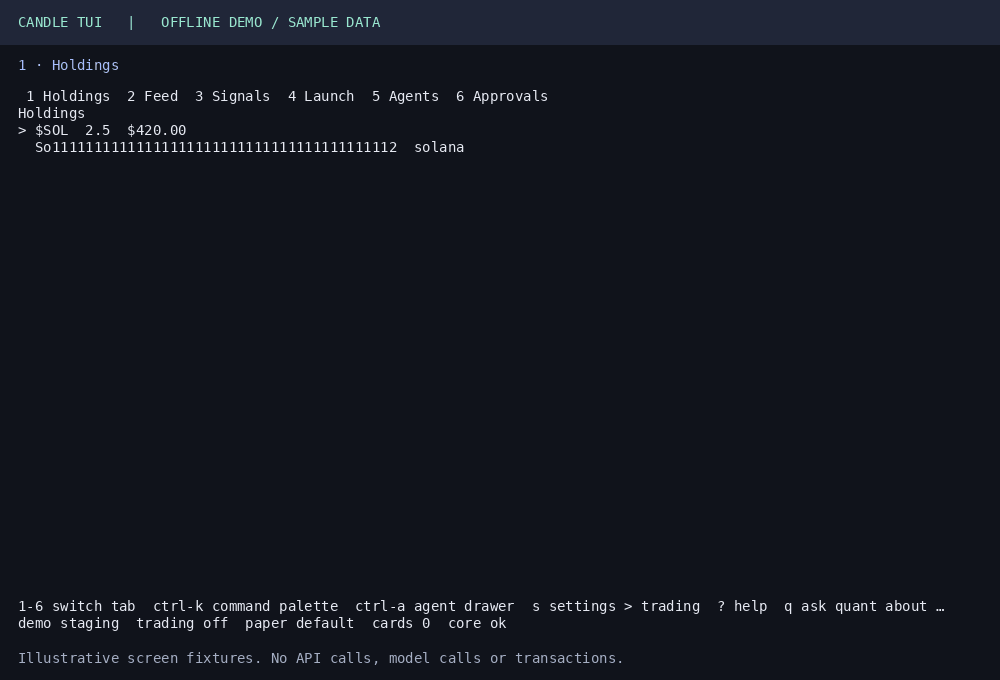

# Candle TUI

The Candle terminal app, for trading and launching from your terminal. It attaches to the local
Candle core that the [Candle CLI](https://github.com/candledottv/agentic) runs, and it holds no
keys: signing and approvals stay in the core, which is open source.

> **Coming.** The first release is not out yet. Nothing here installs until it is.

This repository holds the signed binaries, the issue tracker and the documentation. The TUI itself
is closed source. The trust-critical code (signer, approval cards, classifier, executor, journal and
the socket server) is the CLI's, and it is public.



The animation renders the actual screens with offline sample data, including an illustrative
Quant answer. It makes no API/model calls or transactions.

## Install

Needs the Candle CLI first, and macOS 13 or later, or Linux.
The installer requires `curl`, `sha256sum` or `shasum`, and **cosign 2.5.2 or later**
(`brew install cosign` on macOS; see [cosign releases](https://github.com/sigstore/cosign/releases)
on Linux). GitHub CLI (`gh`) cannot verify these private-build provenance records.

```sh
curl -fsSL https://github.com/candledottv/tui/releases/latest/download/install.sh | bash
```

The installer downloads the binary for your machine, checks its SHA-256, and **verifies its
Sigstore signature** with `cosign` before it writes anything. Without cosign it stops;
`CANDLE_INSTALL_ALLOW_UNSIGNED=1` installs on the checksum alone. It installs `candle-tui` into
`~/.local/bin`, next to `candle`. Then:

```sh
candle tui
```

## Verify a download yourself

Each release asset has a `.sigstore.json` bundle beside it. The signing identity is the release
workflow of the private build repository, on the tag of that release:

```sh
cosign verify-blob --new-bundle-format \
  --bundle candle-tui-darwin-arm64.sigstore.json \
  --certificate-identity "https://github.com/candledottv/candle-monorepo/.github/workflows/release-tui.yaml@refs/tags/tui-v<version>" \
  --certificate-oidc-issuer https://token.actions.githubusercontent.com \
  candle-tui-darwin-arm64
```

`candle-tui --licenses` prints the licences of the third-party software inside the binary.

## Build your own view

The core's local socket is documented: [docs/attach-protocol.md](docs/attach-protocol.md).

## Issues

Bug reports and requests go in this repository's issues. Never paste a key, a seed phrase or a
token.
